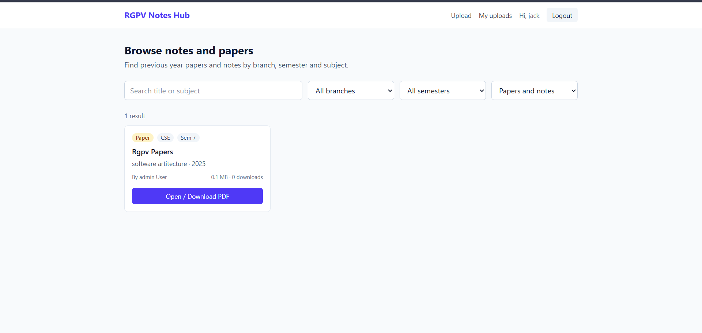
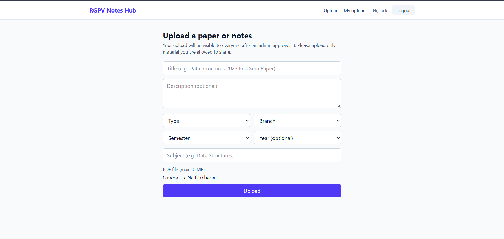
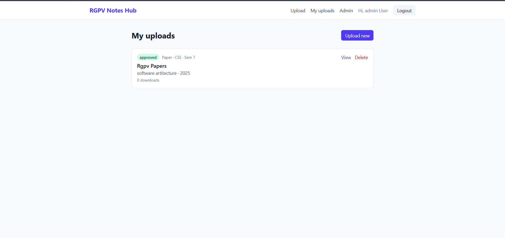

# RGPV Notes Hub

A full-stack platform where RGPV students can find, share and download previous year question papers and notes, organised by branch, semester and subject. Every upload is reviewed by an admin before it becomes public.

**Live demo:** https://rgpv-notes-hub-theta.vercel.app
**API health check:** https://rgpv-notes-hub-api.onrender.com/api/health

> The backend runs on a free Render instance. If nobody has used it for a while, the first request can take 30-60 seconds while the server wakes up.

## Why I built it

Students currently look for old papers and notes in scattered WhatsApp groups. This project puts everything in one searchable place, with a review step so spam and wrong files do not reach other students.

## Screenshots

| Browse and filter | Upload | Admin review |
|---|---|---|
|  |  |  |

## Features

**Students**
- Register and log in (JWT authentication)
- Browse approved papers and notes with filters (branch, semester, type), text search and pagination
- Open or download a PDF; a download counter is kept per document
- Upload a PDF with branch, semester, subject and year
- "My uploads" page showing each upload as pending, approved or rejected, with delete

**Admin**
- Review queue of pending uploads with a link to preview the PDF
- Approve or reject with one click
- Delete any document (also removes the file from cloud storage)

## Tech stack

| Layer | Technology |
|---|---|
| Frontend | React (Vite), React Router, Axios, Tailwind CSS |
| Backend | Node.js, Express |
| Database | MongoDB Atlas with Mongoose |
| File storage | Cloudinary (PDFs uploaded as raw files) |
| Auth | JWT, bcrypt password hashing |
| Security | helmet, CORS allow-list, express-rate-limit, Multer file validation |
| Hosting | Vercel (frontend), Render (backend) |

## How it works

```
Browser (React on Vercel)
   |  HTTPS + Authorization: Bearer <JWT>
   v
Express API (Render)  --->  MongoDB Atlas  (users, documents)
   |
   +--->  Cloudinary  (PDF files)
```

Upload flow: the browser sends a multipart form to the API, Multer keeps the file in memory after checking type (PDF only) and size (max 10 MB), the API streams it to Cloudinary, and saves the returned URL with the document details in MongoDB with `status: pending`. An admin approves it, and only then does it appear in the public list.

## Project structure

```
rgpv-notes-hub/
  backend/
    src/
      config/        db.js, cloudinary.js
      controllers/   authController.js, documentController.js
      middleware/    auth.js (protect, adminOnly), upload.js (Multer)
      models/        User.js, Document.js
      routes/        authRoutes.js, documentRoutes.js
      server.js
  frontend/
    src/
      api/           client.js (Axios instance with token interceptor)
      context/       AuthContext.jsx
      components/    Navbar, ProtectedRoute, DocumentCard
      pages/         Home, Login, Register, Upload, MyUploads, Admin
```

## API reference

| Method | Endpoint | Access | Purpose |
|---|---|---|---|
| POST | `/api/auth/register` | Public | Create a student account |
| POST | `/api/auth/login` | Public | Log in, returns a JWT |
| GET | `/api/auth/me` | Logged in | Current user |
| GET | `/api/documents` | Public | Approved documents. Query: `branch`, `semester`, `subject`, `year`, `type`, `q`, `page`, `limit` |
| GET | `/api/documents/:id` | Public | One approved document |
| POST | `/api/documents` | Logged in | Upload a PDF (multipart form) |
| GET | `/api/documents/mine` | Logged in | My uploads with status |
| POST | `/api/documents/:id/download` | Public | Increase download count, returns file URL |
| DELETE | `/api/documents/:id` | Owner or admin | Delete document and cloud file |
| GET | `/api/documents/admin/pending` | Admin | Pending review queue |
| PATCH | `/api/documents/:id/status` | Admin | Approve or reject |

## Run it locally

Requirements: Node.js 20+, a MongoDB Atlas cluster, a Cloudinary account.

```powershell
git clone https://github.com/GoluSen/rgpv-notes-hub.git
cd rgpv-notes-hub

# Backend
cd backend
Copy-Item .env.example .env      # then fill in the values
npm install
npm run dev

# Frontend (new terminal)
cd frontend
Copy-Item .env.example .env
npm install
npm run dev
```

Frontend runs on http://localhost:5173 and the API on http://localhost:5000.

To create an admin: register a normal account, then set its `role` field to `admin` in the `users` collection (Atlas > Browse Collections). Roles are never accepted from the request body, so this cannot be done from the app.

### Environment variables

**backend/.env**

| Name | Description |
|---|---|
| `PORT` | API port (default 5000) |
| `MONGO_URI` | MongoDB Atlas connection string |
| `JWT_SECRET` | Long random string used to sign tokens |
| `CLIENT_URL` | Frontend origin allowed by CORS |
| `CLOUDINARY_CLOUD_NAME`, `CLOUDINARY_API_KEY`, `CLOUDINARY_API_SECRET` | Cloudinary credentials |

**frontend/.env**

| Name | Description |
|---|---|
| `VITE_API_URL` | Base URL of the API, for example `http://localhost:5000/api` |

## Security decisions

- Passwords are hashed with bcrypt and never returned by the API (`select: false`)
- The role is stored in the database and checked on every request, so a role change takes effect immediately; the signup endpoint ignores any role sent by the client
- Login returns the same error for a wrong email and a wrong password, so accounts cannot be enumerated
- Uploads are limited to PDF and 10 MB, and held in memory, never written to the server disk
- Search input is regex-escaped before being used in a MongoDB query
- helmet headers, a CORS allow-list and rate limiting on all API routes
- Secrets live in environment variables; only `.env.example` files are committed

## Deployment notes

- Vercel needs `vercel.json` with a rewrite to `index.html` so that deep links like `/admin` work with React Router
- Render sits behind a proxy, so Express uses `trust proxy` for correct per-user rate limiting
- Vite reads `VITE_*` variables at build time, so the frontend must be redeployed after changing them

## Known limitations and next steps

- The JWT is kept in localStorage; moving to an httpOnly cookie would reduce XSS risk
- No email verification or password reset yet
- No automated tests yet (planned: Jest and Supertest for the API)
- Uploaded PDFs are not scanned for malware; moderation relies on admin review
- Free-tier hosting: cold start on Render and storage limits on Cloudinary

## Author

Golu Sen. Computer Engineering student (RGPV, Bhopal).
GitHub: https://github.com/GoluSen
